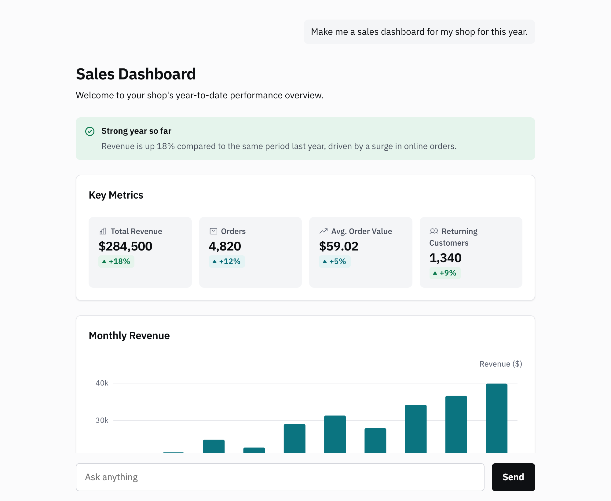

# MorphScreen starter for React

A React chat where the model answers with UI: charts, tables, forms and buttons, drawn while the answer streams. Vite, Express and [`@morphscreen/web`](https://www.npmjs.com/package/@morphscreen/web).

<p align="center">
  <picture>
    <source media="(prefers-color-scheme: dark)" srcset="docs/chat-dark.png">
    <source media="(prefers-color-scheme: light)" srcset="docs/chat-light.png">
    
  </picture>
</p>

<p align="center"><i>A recorded DeepSeek V4 Flash answer, drawn by this starter.</i></p>

## Run it

You need Node.js 20.6 or later and a MorphScreen key. The free plan includes calls on our model, so you don't need a model key: [sign up](https://app.morphscreen.com/signin) and copy the key from the welcome page.

```sh
git clone https://github.com/morphscreen/starter-react my-chat
cd my-chat
npm install
cp .env.example .env    # then put your key in .env
```

Then, in two terminals:

```sh
npm run server    # the API route, on port 3000
```

```sh
npm run dev       # the page, with /api passed to the server
```

Open the address Vite prints and ask for something with shape: "compare three phones under $500", "a form to book a table for four", "plan a weekend in Lisbon with a budget".

## What's in it

| File | What it does |
| --- | --- |
| `server.mjs` | `/api/agent` adds your key and the model and passes each run to MorphScreen's `/v1/ui`; `/api/chat` streams chat completions for a chat UI of your own |
| `src/main.tsx` | the chat: `connectAgent` draws each answer as it streams and sends buttons and forms back as the next turn |
| `src/style.css` | the page around the chat, in the SDK's theme tokens, so it follows light and dark |
| `vite.config.ts` | passes `/api` from Vite's dev server to `server.mjs` |

The key stays on the server; the page never sees it. For a model other than the one in your plan, set `MODEL` in `.env` to any model on OpenRouter and add `Authorization: Bearer <your OpenRouter key>` to the headers in `server.mjs` ([the API's headers](https://morphscreen.com/docs/reference/api)).

## Going further

- [Generative UI in React](https://morphscreen.com/docs/guides/generative-ui-react), the guide this starter follows
- [Components](https://morphscreen.com/docs/components): what the model can draw, and [your own components](https://morphscreen.com/docs/format/custom-components)
- [Theming](https://morphscreen.com/docs/format/theming) to match the answer to your app

For production, build with `npm run build`, serve `dist/` from any static host, and run `server.mjs` (or the same route in your own server) behind `/api`.

## Licence

Apache-2.0
